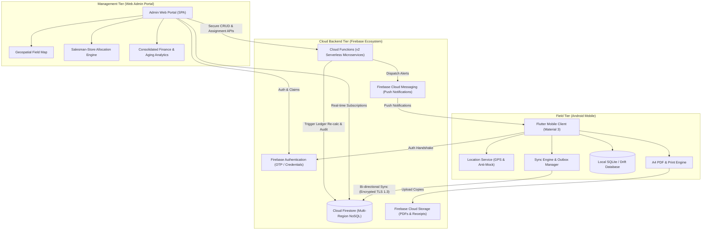
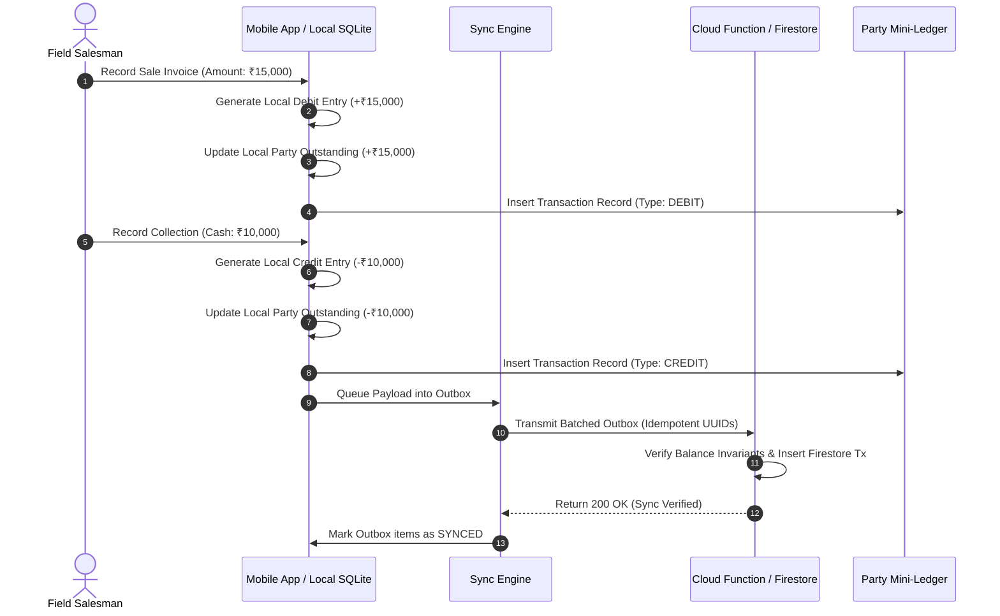

# AUPL Sales Team App — System Architecture Specification (ARCHITECTURE.md)

**Company:** ANSU UDYOG PRIVATE LIMITED (AUPL)  
**System Name:** AUPL Sales Enterprise Management Architecture  
**Document Version:** 1.0.0  

---

## 1. High-Level Architecture Overview

The AUPL Sales Enterprise System is designed as an **Offline-First Distributed Mobile Client** paired with a **Serverless Cloud Native Backend** and a **Real-Time Responsive Web Admin Portal**.



---

## 2. Technology Stack & Component Breakdown

| Tier | Component | Technology / Library | Purpose & Rationale |
|---|---|---|---|
| **Mobile Client** | Framework | Flutter SDK 3.x (Dart 3.x) | Single codebase for high-performance native Android binary with smooth Material 3 UI. |
| | State Management | `Provider` + `ChangeNotifier` / `Bloc` | Predictable state flow, reactive UI bindings, separation of UI and business logic. |
| | Local Storage | `sqflite` (SQLite) / `drift` | Robust relational local storage with ACID compliance, vital for complex ledger joins offline. |
| | Geolocation | `geolocator` + Anti-Mock Checks | Precise GPS coordinates, accuracy filtering, and hardware mock detection. |
| | PDF & Printing | `pdf` + `printing` | Pixel-perfect A4 invoice/ledger generation and native print spooler/Bluetooth integration. |
| | Networking | `connectivity_plus` + `dio` / `cloud_firestore` | Network state detection and resilient retrying. |
| **Admin Web Portal**| Web Framework | Flutter Web / React (Vite) + Tailwind CSS | Fast, desktop-optimized dashboard with rapid rendering of data tables and maps. |
| | Maps & Geo | Google Maps JS SDK / Leaflet | Interactive outlet plotting and live salesman tracking. |
| | State & Query | React Query / Firestore SDK | Optimistic updates and real-time subscription management. |
| **Cloud Backend** | Auth | Firebase Authentication | Secure phone OTP and email authentication with Custom Claims for RBAC. |
| | Primary Database | Cloud Firestore | Highly available, multi-tenant NoSQL database with offline caching capabilities and real-time streams. |
| | Business Logic | Firebase Cloud Functions (Node.js 20) | Server-side validation, financial ledger invariants, auto-numbering, and audit logging. |
| | Storage | Firebase Cloud Storage | Secure object storage for exported PDF invoices, signed receipts, and outlet store photos. |
| | Push Notifications| Firebase Cloud Messaging (FCM) | Daily morning route briefings, target alerts, and manager broadcasts. |

---

## 3. Data Hierarchy Model

The system enforces a strict 4-level geographical hierarchy originating from AUPL headquarters:

```
[State: e.g. Uttar Pradesh]
   │
   └──► [District: e.g. Kanpur]
          │
          └──► [Market: e.g. Civil Lines]
                 │
                 └──► [Outlet: e.g. Sharma Medical Store]
                        │
                        └──► [Assigned Salesman: ID, Name, Mobile]
                               (Access Boundary: Only sees his mapped outlets)
```

### Hierarchy Constraints:
1. Every **Market** strictly belongs to exactly one **District** and one **State**.
2. Every **Outlet** belongs to exactly one **Market**.
3. A **Salesman** is assigned either at:
   - Specific Outlets (Granular store assignment).
   - An entire Market (All outlets within that market).
   - An entire District (All markets within that district).
4. When queried on mobile, the salesman receives a flat compiled list of authorized outlet IDs computed by the Cloud Function / Assignment Matrix.

---

## 4. Financial Ledger Calculation Engine

To fulfill **Rule 7 & 8: All transactions update the party ledger automatically & Outstanding is auto-calculated**:



### Ledger Invariants:
* **Opening Balance:** Read-only baseline set during outlet onboarding.
* **Current Outstanding Formula:**
  $$\text{Current Outstanding} = \text{Opening Balance} + \sum(\text{Sales Invoices}) - \sum(\text{Collections}) - \sum(\text{Sales Returns})$$
* **Mini-Ledger Entry Types:**
  - `OPENING`: Initial balance brought forward.
  - `SALE_INVOICE`: Debit entry (increases party debt).
  - `COLLECTION_CASH`: Credit entry (decreases party debt).
  - `COLLECTION_UPI`: Credit entry (decreases party debt, requires reference ID).
  - `COLLECTION_CHEQUE`: Credit entry (status: PENDING until cleared by Admin).
  - `SALES_RETURN`: Credit entry (authorized credit note).

---

## 5. GPS Geofencing & Verification Engine

To fulfill **Rule 3 & 4: Outlet visit requires GPS verification & Visited cannot be marked from outside the outlet**:

1. **Hardware Coordinate Acquisition:**
   - Obtains high-accuracy coordinates (`Latitude`, `Longitude`, `Accuracy` in meters).
   - Verifies accuracy is $\le 25\text{ m}$. If GPS accuracy is degraded (e.g. $\ge 50\text{ m}$), the app prompts the user to move to open sky.
2. **Anti-Mock Location Detection:**
   - Checks Android `Location.isFromMockProvider()` or `location.isMock`.
   - If mock location is active, the check-in is instantly rejected and an audit alert is triggered.
3. **Geodesic Distance Verification (Haversine Formula):**
   $$d = 2r \arcsin\left(\sqrt{\sin^2\left(\frac{\Delta \phi}{2}\right) + \cos(\phi_1)\cos(\phi_2)\sin^2\left(\frac{\Delta \lambda}{2}\right)}\right)$$
4. **Validation Policy:**
   - If distance $d \le 100\text{ meters}$: Check-in permitted; UI reveals "Outlet Dashboard" (Sale & Collection enabled).
   - If distance $d > 100\text{ meters}$: Check-in blocked with descriptive error: *"You are 280m away from Sharma Medical Store. Please reach the store to check in."*

---

## 6. Offline-First Synchronization Architecture

The mobile app relies on the **Outbox Pattern**:
* **Optimistic Local Execution:** Every action (check-in, invoice creation, collection entry) is immediately committed to local SQLite and visible in the UI with a pending sync indicator (`Pending ⏳`).
* **Persistent Outbox Table:** Records store `operation_type`, `payload_json`, `idempotency_key` (UUID v4), `created_at`, `sync_status` (`PENDING`, `IN_PROGRESS`, `SUCCESS`, `FAILED`), and `retry_count`.
* **Idempotency Guarantee:** Server uses the client's `idempotency_key` as the Firestore Document ID. Re-transmissions will never create duplicate invoices or payment entries.

---

## 7. Security & Role-Based Access Control (RBAC)

1. **Super Admin:** Unrestricted read/write across all states, districts, outlets, financial ledgers, and master settings.
2. **State / District Manager:** Scoped read/write to assigned territories; cannot modify global product master or tax slabs.
3. **Field Salesman:** Strictly isolated to assigned outlets; read-only access to product catalog; write access to visits, sales, and collections linked only to their assigned outlets during active sessions.
