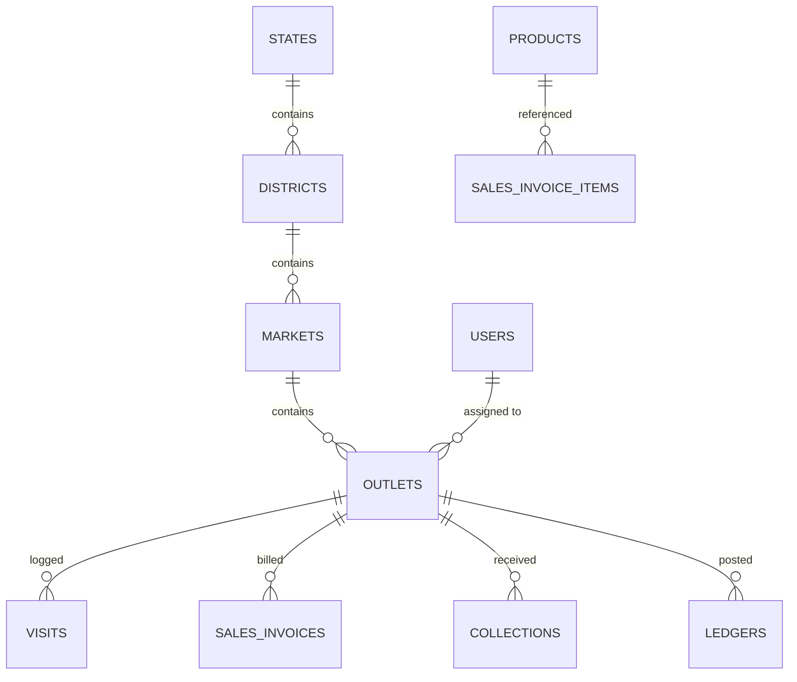

# AUPL Sales Team App — Database Architecture & Schema (DATABASE.md)

**Company:** ANSU UDYOG PRIVATE LIMITED (AUPL)  
**Backend:** Cloud Firestore (Production Cloud DB) + SQLite / Drift (Offline Local DB)  
**Document Version:** 1.0.0  

---

## 1. Cloud Firestore NoSQL Data Model

Cloud Firestore serves as the central operational database. Collections are structured to facilitate **strict security rules**, **real-time synchronization**, and **isolated query boundaries** for field sales personnel.



---

## 2. Firestore Collections & Document Schemas

### 2.1 Collection: `users`
Stores credentials metadata, organizational hierarchy, and assigned territory boundaries.
* **Document ID:** `user_id` (matches Firebase Auth UID)
```json
{
  "userId": "uid_rajesh_004",
  "employeeId": "AUPL-SM-004",
  "fullName": "Rajesh Kumar",
  "mobileNumber": "+919839012345",
  "email": "rajesh.k@ansushop.com",
  "role": "SALESMAN", // "SUPER_ADMIN" | "AREA_MANAGER" | "SALESMAN"
  "designation": "Senior Sales Executive",
  "assignedTerritory": {
    "stateIds": ["state_up"],
    "districtIds": ["dist_kanpur"],
    "marketIds": ["mkt_civil_lines", "mkt_mall_road"],
    "assignedOutletIds": ["out_1042", "out_1043", "out_1045"]
  },
  "targets": {
    "monthlySales": 500000.0,
    "monthlyCollection": 450000.0,
    "dailyVisitsTarget": 25
  },
  "currentSession": {
    "deviceId": "android_hardware_id_abc123",
    "lastLoginAt": "2026-10-12T08:30:00Z"
  },
  "isActive": true,
  "createdAt": "2026-01-15T10:00:00Z",
  "updatedAt": "2026-10-12T08:30:00Z"
}
```

### 2.2 Collections: Territorial Masters (`states`, `districts`, `markets`)
* **Collection:** `states`  
  Document ID: `state_id` (e.g., `state_up`)
  ```json
  { "stateId": "state_up", "stateName": "Uttar Pradesh", "stateCode": "UP", "isActive": true }
  ```
* **Collection:** `districts`  
  Document ID: `district_id` (e.g., `dist_kanpur`)
  ```json
  { "districtId": "dist_kanpur", "stateId": "state_up", "districtName": "Kanpur Nagar", "isActive": true }
  ```
* **Collection:** `markets`  
  Document ID: `market_id` (e.g., `mkt_civil_lines`)
  ```json
  { "marketId": "mkt_civil_lines", "districtId": "dist_kanpur", "stateId": "state_up", "marketName": "Civil Lines", "totalOutlets": 48, "isActive": true }
  ```

### 2.3 Collection: `outlets`
Central repository of retail partners.
* **Document ID:** `outlet_id` (e.g., `out_1042`)
```json
{
  "outletId": "out_1042",
  "outletCode": "AUPL-OUT-1042",
  "outletName": "Sharma Medical Store",
  "proprietorName": "Rajesh Sharma",
  "mobileNumber": "+919839098765",
  "gstin": "09AAAAA0000A1Z5",
  "address": "Shop 14, Main Road, Civil Lines, Kanpur, UP - 208001",
  "stateId": "state_up",
  "districtId": "dist_kanpur",
  "marketId": "mkt_civil_lines",
  "coordinates": {
    "latitude": 26.46743,
    "longitude": 80.35032
  },
  "geofenceRadiusMeters": 100,
  "creditLimit": 50000.0,
  "paymentTermsDays": 15,
  "openingBalance": 10000.0,
  "currentOutstanding": 18400.0,
  "assignedSalesmanIds": ["uid_rajesh_004"],
  "lastVisitedAt": "2026-10-12T11:20:00Z",
  "isActive": true,
  "createdAt": "2026-02-01T09:00:00Z",
  "updatedAt": "2026-10-12T11:35:00Z"
}
```

### 2.4 Collection: `products` (SKU Master)
* **Document ID:** `sku_id` (e.g., `sku_aupl_500ml`)
```json
{
  "skuId": "sku_aupl_500ml",
  "skuCode": "SKU-AUPL-01",
  "productName": "Ansu Clean Floor Wash 500ml",
  "category": "Household Cleaning",
  "packSize": "500ml Bottle (Carton of 24)",
  "mrp": 120.0,
  "baseRate": 85.0,
  "gstPercentage": 18.0,
  "hsnCode": "3402",
  "isActive": true,
  "createdAt": "2026-01-01T00:00:00Z"
}
```

### 2.5 Collection: `visits`
Captures GPS geofenced check-in and check-out logs.
* **Document ID:** `visit_id` (UUID generated on client)
```json
{
  "visitId": "9b1deb4d-3b7d-4bad-9bdd-2b0d7b3dcb6d",
  "outletId": "out_1042",
  "salesmanId": "uid_rajesh_004",
  "marketId": "mkt_civil_lines",
  "checkInTime": "2026-10-12T11:20:15Z",
  "checkInLocation": {
    "latitude": 26.46745,
    "longitude": 80.35029,
    "accuracyMeters": 12.4
  },
  "distanceFromOutletMeters": 3.8,
  "isGpsVerified": true,
  "isMockLocation": false,
  "checkOutTime": "2026-10-12T11:42:00Z",
  "visitDurationMinutes": 21.7,
  "saleRecorded": true,
  "collectionRecorded": true,
  "remarks": "Owner requested promotional banner for Diwali",
  "createdAt": "2026-10-12T11:20:15Z"
}
```

### 2.6 Collection: `sales_invoices`
Stores immutable sales order records.
* **Document ID:** `invoice_id` (UUID generated on client)
```json
{
  "invoiceId": "f47ac10b-58cc-4372-a567-0e02b2c3d479",
  "invoiceNumber": "AUPL-INV-2026-104",
  "outletId": "out_1042",
  "salesmanId": "uid_rajesh_004",
  "visitId": "9b1deb4d-3b7d-4bad-9bdd-2b0d7b3dcb6d",
  "marketId": "mkt_civil_lines",
  "invoiceDate": "2026-10-12",
  "items": [
    {
      "skuId": "sku_aupl_500ml",
      "skuCode": "SKU-AUPL-01",
      "productName": "Ansu Clean Floor Wash 500ml",
      "quantity": 10,
      "baseRate": 85.0,
      "discountPercent": 5.0,
      "taxableAmount": 807.50,
      "gstPercentage": 18.0,
      "gstAmount": 145.35,
      "totalAmount": 952.85
    }
  ],
  "totalQuantity": 10,
  "subtotal": 850.0,
  "totalDiscount": 42.50,
  "totalGst": 145.35,
  "grandTotal": 952.85,
  "paymentTerms": "CREDIT",
  "isPostedToLedger": true,
  "pdfStorageUrl": "gs://ansushop.appspot.com/invoices/2026/10/AUPL-INV-2026-104.pdf",
  "createdAt": "2026-10-12T11:30:00Z"
}
```

### 2.7 Collection: `collections`
Stores payment receipt logs.
* **Document ID:** `collection_id` (UUID generated on client)
```json
{
  "collectionId": "c8a42b10-67c2-4011-8be3-5813f8c05e32",
  "receiptNumber": "AUPL-RCP-2026-088",
  "outletId": "out_1042",
  "salesmanId": "uid_rajesh_004",
  "visitId": "9b1deb4d-3b7d-4bad-9bdd-2b0d7b3dcb6d",
  "marketId": "mkt_civil_lines",
  "collectionDate": "2026-10-12",
  "amountCollected": 5000.0,
  "paymentMode": "UPI", // "CASH" | "UPI" | "CHEQUE"
  "upiDetails": {
    "utrReferenceNumber": "628519402851"
  },
  "chequeDetails": null,
  "status": "APPROVED", // "APPROVED" | "PENDING_CLEARING" | "BOUNCED"
  "isPostedToLedger": true,
  "createdAt": "2026-10-12T11:35:00Z"
}
```

### 2.8 Collection: `ledgers`
Stores append-only financial ledger entries per outlet.
* **Document ID:** `ledger_id` (e.g., `led_out1042_seq_015`)
```json
{
  "ledgerId": "led_out1042_seq_015",
  "outletId": "out_1042",
  "sequenceNumber": 15,
  "transactionDate": "2026-10-12T11:35:00Z",
  "transactionType": "COLLECTION_UPI", // "OPENING" | "SALE_INVOICE" | "COLLECTION_CASH" | "COLLECTION_UPI" | "COLLECTION_CHEQUE" | "SALES_RETURN"
  "voucherNumber": "AUPL-RCP-2026-088",
  "referenceId": "c8a42b10-67c2-4011-8be3-5813f8c05e32",
  "debitAmount": 0.0,
  "creditAmount": 5000.0,
  "runningBalance": 18400.0,
  "remarks": "Part collection against overdue bills",
  "recordedBySalesmanId": "uid_rajesh_004",
  "createdAt": "2026-10-12T11:35:00Z"
}
```

---

## 3. Local SQLite Database Schema (Mobile Device)

The local SQLite schema mirrors the cloud data model to allow seamless offline queries, joins, and instant ledger balance updates.

### 3.1 Core Local Tables
```sql
-- Territorial Outlets Cache
CREATE TABLE local_outlets (
    outlet_id TEXT PRIMARY KEY,
    outlet_code TEXT NOT NULL,
    outlet_name TEXT NOT NULL,
    proprietor_name TEXT,
    mobile_number TEXT,
    address TEXT,
    market_id TEXT NOT NULL,
    district_id TEXT NOT NULL,
    state_id TEXT NOT NULL,
    latitude REAL NOT NULL,
    longitude REAL NOT NULL,
    geofence_radius INTEGER DEFAULT 100,
    credit_limit REAL NOT NULL,
    opening_balance REAL NOT NULL,
    current_outstanding REAL NOT NULL,
    is_assigned INTEGER DEFAULT 1,
    last_visited_at TEXT,
    updated_at TEXT NOT NULL
);

-- Local SKU Catalog
CREATE TABLE local_products (
    sku_id TEXT PRIMARY KEY,
    sku_code TEXT NOT NULL,
    product_name TEXT NOT NULL,
    category TEXT,
    pack_size TEXT,
    mrp REAL NOT NULL,
    base_rate REAL NOT NULL,
    gst_percentage REAL NOT NULL,
    is_active INTEGER DEFAULT 1
);

-- Offline Outbox Queue (Transaction Dispatcher)
CREATE TABLE sync_outbox (
    outbox_id TEXT PRIMARY KEY, -- Client UUID v4
    operation_type TEXT NOT NULL, -- 'CHECK_IN', 'SALE_INVOICE', 'COLLECTION', 'CHECK_OUT'
    entity_id TEXT NOT NULL, -- invoice_id or collection_id
    payload_json TEXT NOT NULL,
    created_at TEXT NOT NULL,
    sync_status TEXT DEFAULT 'PENDING', -- 'PENDING', 'SYNCING', 'SYNCED', 'FAILED'
    retry_count INTEGER DEFAULT 0,
    last_error TEXT
);

-- Local Immutable Ledger Entries
CREATE TABLE local_ledger (
    ledger_id TEXT PRIMARY KEY,
    outlet_id TEXT NOT NULL,
    voucher_number TEXT NOT NULL,
    transaction_date TEXT NOT NULL,
    transaction_type TEXT NOT NULL,
    debit_amount REAL DEFAULT 0.0,
    credit_amount REAL DEFAULT 0.0,
    running_balance REAL NOT NULL,
    sync_status TEXT DEFAULT 'SYNCED',
    FOREIGN KEY(outlet_id) REFERENCES local_outlets(outlet_id)
);
```

---

## 4. Firestore Composite Index Requirements

To enable efficient filtered queries without runtime table scans:

1. **Assigned Outlets Query:**
   - Collection: `outlets`
   - Fields: `assignedSalesmanIds` (Array-Contains) + `marketId` (Asc) + `currentOutstanding` (Desc)
2. **Salesman Visits by Date:**
   - Collection: `visits`
   - Fields: `salesmanId` (Asc) + `checkInTime` (Desc)
3. **Outlet Ledger Chronology:**
   - Collection: `ledgers`
   - Fields: `outletId` (Asc) + `transactionDate` (Asc)
4. **Debtor Aging Query:**
   - Collection: `outlets`
   - Fields: `marketId` (Asc) + `currentOutstanding` (Desc)
