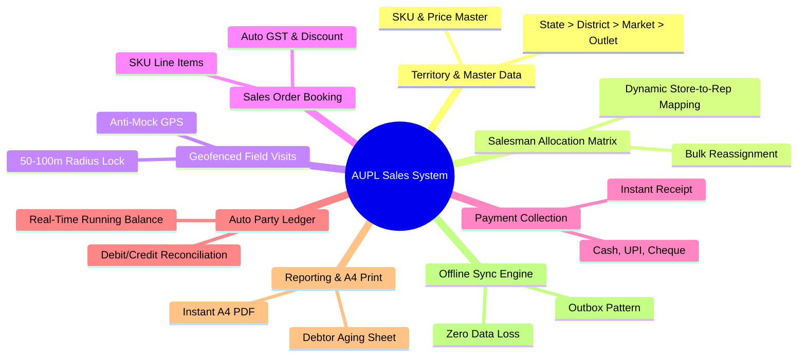

# AUPL Sales Team App — Detailed Feature Specifications (FEATURES.md)

**Company:** ANSU UDYOG PRIVATE LIMITED (AUPL)  
**Document Version:** 1.0.0  

---

## 1. Feature Breakdown Matrix

The system functionality spans the **Mobile Field Sales Client** and the **Web Admin Portal**, structured across 10 core capability pillars.

---

## 2. Core Functional Modules

### Feature 1: Territorial Hierarchy & Master Data Management
* **Description:** Establishes the canonical organizational hierarchy (`State -> District -> Market -> Outlet`) and product catalog for ANSU UDYOG PRIVATE LIMITED.
* **Mobile Capabilities:**
  * Displays pre-filtered hierarchy trees based on assigned scope.
  * Instant search and indexing across markets and stores.
* **Admin Web Capabilities:**
  * Add, edit, archive States, Districts, Markets, and Retail Outlets.
  * Tag precise GPS coordinates ($\text{Latitude}, \text{Longitude}$) for each store using an interactive map picker.
  * Configure store credit limits (₹), payment terms (e.g. 15, 30 days), and separate opening balances.
  * SKU Master control: SKU code, product name, pack size, MRP, distributor base rate, HSN codes, and GST slabs (5%, 12%, 18%, 28%).

---

### Feature 2: Salesman Allocation & Route Matrix (Admin Core)
* **Description:** A flexible management tool enabling administrators to select any sales executive and assign, adjust, or transfer their store portfolio.
* **Capabilities:**
  * **Salesman Picker:** Instant profile preview showing current route, assigned market count, total active stores, and daily targets.
  * **Granular Store Assignment:** Assign at the Outlet level, Market level, or District level.
  * **Store Reassignment Wizard:** When a salesman resigns or transitions territories, transfer all his stores to a peer salesman in one transaction.
  * **Territory Workload Balancer:** Visual indicators flag overloaded or under-allocated routes.

---

### Feature 3: GPS Geofenced Visit & Check-In Verification
* **Description:** Guarantees that sales representatives are physically present inside or directly in front of the retail store prior to logging transactions (**Rules 3 & 4**).
* **Mobile Capabilities:**
  * Calculates real-time distance from user's current GPS to store coordinates.
  * Enforces a strict geofence radius ($50\text{ m} - 100\text{ m}$).
  * Check-In button is locked with dynamic distance label (`📍 145m away - Move closer to check in`).
  * Unlocks immediately upon entering the geofence radius with haptic pulse.
  * Anti-Mock detection: Blocks mock location applications (e.g., Fake GPS) and reports attempt to admin.
* **Admin Web Capabilities:**
  * Live monitoring of all active store visits on an interactive map.
  * Inspect visit duration, check-in timestamp, and distance recorded at time of check-in.

---

### Feature 4: SKU-Based Sales Order Booking
* **Description:** Fast, mistake-proof order entry for field representatives.
* **Capabilities:**
  * Browse products categorized by brand/category with SKU codes.
  * Fast quantity adjustment with increment/decrement steppers and direct numeric entry.
  * Configurable dealer discounts (% or flat ₹).
  * Automated tax calculation (CGST + SGST or IGST) based on destination state.
  * Real-time credit limit check: Alerts the salesman if the new invoice pushes the party beyond their allocated credit limit.
  * Generates unique invoice number (`AUPL-INV-YYYY-XXXX`).

---

### Feature 5: Multi-Mode Payment Collection
* **Description:** Seamless recording of on-the-spot customer payments.
* **Capabilities:**
  * **Cash:** Logs cash collected and auto-updates the salesman's "Daily Cash in Hand" ledger.
  * **UPI:** Displays AUPL dynamic merchant UPI QR code. Requires mandatory entry of the 12-digit UPI Transaction Reference (UTR) number to prevent false entries.
  * **Cheque:** Captures Cheque Number, Bank Name, Branch, Cheque Date, and optional photo of the cheque leaf. Marked as `PENDING_CLEARANCE` until confirmed by HO Finance.
  * Generates instant digital receipt with WhatsApp/SMS shareable link.

---

### Feature 6: Auto-Updating Party Ledger & Running Outstanding
* **Description:** Real-time ledger maintenance eliminating manual book-keeping and end-of-month reconciliations (**Rules 7 & 8**).
* **Capabilities:**
  * **Opening Balance Isolation:** Opening balances are recorded separately and cannot be overwritten by field transactions.
  * **Atomic Debit/Credit Postings:** Invoices instantly increment party debit; collections instantly decrement debit (credit entry).
  * **Mini-Ledger View:** Mobile screen showing chronological account history with running balance after every single transaction.

---

### Feature 7: A4 Print & PDF Statement Export Engine
* **Description:** Single-click generation of professional, print-ready documents formatted for both mobile and desktop (**Rules 14 & 15**).
* **Capabilities:**
  * Generates standardized ISO A4 PDF statements featuring AUPL corporate header, tax identifiers, party profile, transaction table, and authorized sign-off box.
  * Native integration with Bluetooth thermal mobile printers (ESC/POS 2" & 3" rolls) for immediate on-site paper receipt printing.
  * One-click PDF export to device storage or external messaging apps.

---

### Feature 8: Debtor Aging & Consolidated Financial Reports
* **Description:** Comprehensive intelligence for sales executives and financial controllers.
* **Capabilities:**
  * **Company Debtor List:** Single-click listing of all stores with outstanding dues, sorted by highest debt.
  * **Aging Buckets:** Classifies outstanding receivables into:
    * `0–30 Days` (Normal credit cycle)
    * `31–60 Days` (Follow-up required)
    * `61–90 Days` (High priority dues)
    * `90+ Days` (Overdue / Credit locked)
  * **Performance Leaderboards:** Ranks sales representatives by Target vs. Achievement, collections realized, and total verified visits.

---

### Feature 9: Offline-First Operation & Auto-Sync
* **Description:** Uninterrupted field capability in zero-connectivity environments (**Rules 17 & 18**).
* **Capabilities:**
  * All daily operational workflows (viewing assigned stores, check-ins, sales orders, collections, mini-ledger lookups) function 100% offline using local SQLite.
  * Background network listener detects cellular connectivity restoration and dispatches queued transactions in chronological order.
  * Idempotent server processing guarantees zero duplicate invoices or double-counted collections.

---

### Feature 10: Central Audit Trail & Financial Governance
* **Description:** Corporate accountability and fraud prevention (**Rule 11**).
* **Capabilities:**
  * Every transactional event (invoice creation, payment entry, manual ledger adjustment, store assignment change) writes an immutable audit record containing actor ID, timestamp, coordinates, and before/after state diff.
  * Super Admin audit explorer with filter by date, salesman, and event type.
