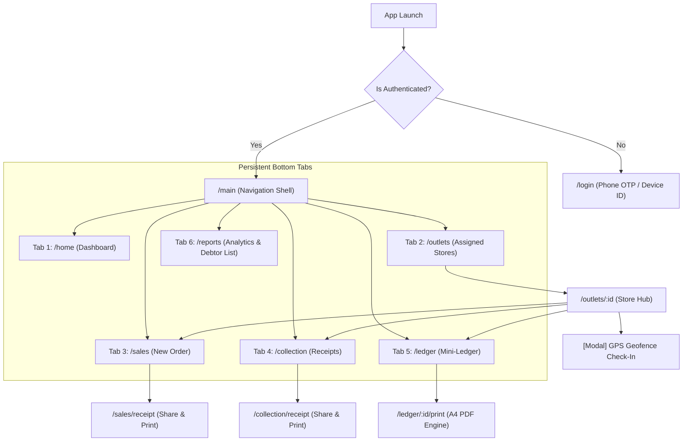

# AUPL Sales Team App — Navigation & Routing Architecture (NAVIGATION.md)

**Company:** ANSU UDYOG PRIVATE LIMITED (AUPL)  
**Platforms:** Flutter Mobile App & Web Admin Portal  
**Document Version:** 1.0.0  

---

## 1. Mobile App Navigation Architecture

The mobile client utilizes a persistent **Bottom Navigation Shell** supporting indexed tab preservation, smooth transition animations, and nested modal workflows.



---

## 2. Mobile Route Registry & Guards

| Route Path | Screen Component | Route Type | Guards & Access Conditions |
|---|---|---|---|
| `/splash` | `SplashScreen` | Unprotected | Initial asset loading and local SQLite DB migration. |
| `/login` | `LoginScreen` | Unprotected | Captures phone number, initiates Firebase OTP. |
| `/otp-verify` | `OtpVerifyScreen` | Unprotected | Verifies OTP code, validates hardware device ID. |
| `/main` | `MainNavigationShell` | Protected | Enforces `AuthGuard` & `DeviceBindingGuard`. |
| `/home` | `DashboardScreen` | Shell Tab 0 | Displays today's KPIs, route progress, outstanding metrics. |
| `/outlets` | `OutletListScreen` | Shell Tab 1 | Displays assigned outlets filtered by State/District/Market. |
| `/outlets/:id` | `OutletDetailScreen` | Stack Push | Store profile, credit health, visit actions. |
| `/outlets/:id/checkin`| `CheckInDialog` | Modal BottomSheet| Runs GPS Haversine verification against store coordinates. |
| `/sales/new` | `AddSaleScreen` | Stack / Shell Tab 2| SKU selector, quantity stepper, tax calculation. |
| `/collection/new` | `AddCollectionScreen` | Stack / Shell Tab 3| Payment mode selection (Cash/UPI/Cheque). |
| `/ledger/:id` | `PartyLedgerScreen` | Stack / Shell Tab 4| Mini-ledger running balance, transaction history. |
| `/ledger/:id/print`| `LedgerPrintScreen` | Fullscreen Stack | A4 PDF rendering, Bluetooth thermal printer dispatch. |
| `/reports` | `ReportsScreen` | Shell Tab 5 | Sales reports, collection reports, debtor list. |

---

## 3. Web Admin Portal Navigation Architecture

The Web Admin Portal features a collapsible, high-density desktop sidebar paired with contextual breadcrumb navigation.

```
┌────────────────────────────────────────────────────────────────────────┐
│ AUPL ADMIN WEB PORTAL — SITEMAP HIERARCHY                              │
│                                                                        │
│ 1. 📊 Dashboard Overview                                               │
│    ├── Live Company Revenue & Target Gauges                            │
│    └── Territory Performance Breakdown (State / District / Market)     │
│                                                                        │
│ 2. 🗺️ Live Field Operations                                            │
│    ├── Interactive Real-Time Map (Geofenced Check-In Pins)             │
│    └── Salesman Live Route Trace & Time Spent per Store                │
│                                                                        │
│ 3. 👥 Salesmen & Team Management                                       │
│    ├── Salesman Directory & Profiles                                   │
│    └── ⚡ STORE-SALESMAN ALLOCATION MATRIX (Select Rep & Assign Stores)│
│                                                                        │
│ 4. 🏬 Territorial Master Hub                                           │
│    ├── States & Districts Management                                   │
│    ├── Markets Directory                                               │
│    └── Retail Outlets Directory (Onboarding, GPS Tagging, Credit Limits)│
│                                                                        │
│ 5. 📦 Product & SKU Catalog                                            │
│    └── Products, MRP, Base Rates, HSN Codes, GST Tax Slabs             │
│                                                                        │
│ 6. 📑 Financial Ledgers & Debtors                                      │
│    ├── Consolidated Company Debtor Aging Sheet (0-30, 31-60, 60+ days) │
│    ├── Individual Party Ledgers & Batch A4 PDF Export                  │
│    └── Payment Approvals (Cheque Clearance Workflow)                   │
│                                                                        │
│ 7. 🛡️ System Governance                                                │
│    ├── Immutable Financial Audit Logs                                  │
│    └── Security & Device Session Management                            │
└────────────────────────────────────────────────────────────────────────┘
```

---

## 4. Deep Linking & Notification Routing

Firebase Cloud Messaging (FCM) push notifications carry structured metadata payloads to route salesmen directly into actionable screens:

* **New Outlet Assignment Alert:**  
  `click_action: "FLUTTER_NOTIFICATION_CLICK"`, payload: `{"route": "/outlets/:id", "outletId": "out_1042"}`
* **Target Achievement Reminder:**  
  Payload: `{"route": "/home"}`
* **Urgent Collection Follow-Up:**  
  Payload: `{"route": "/collection/new", "outletId": "out_1042"}`
