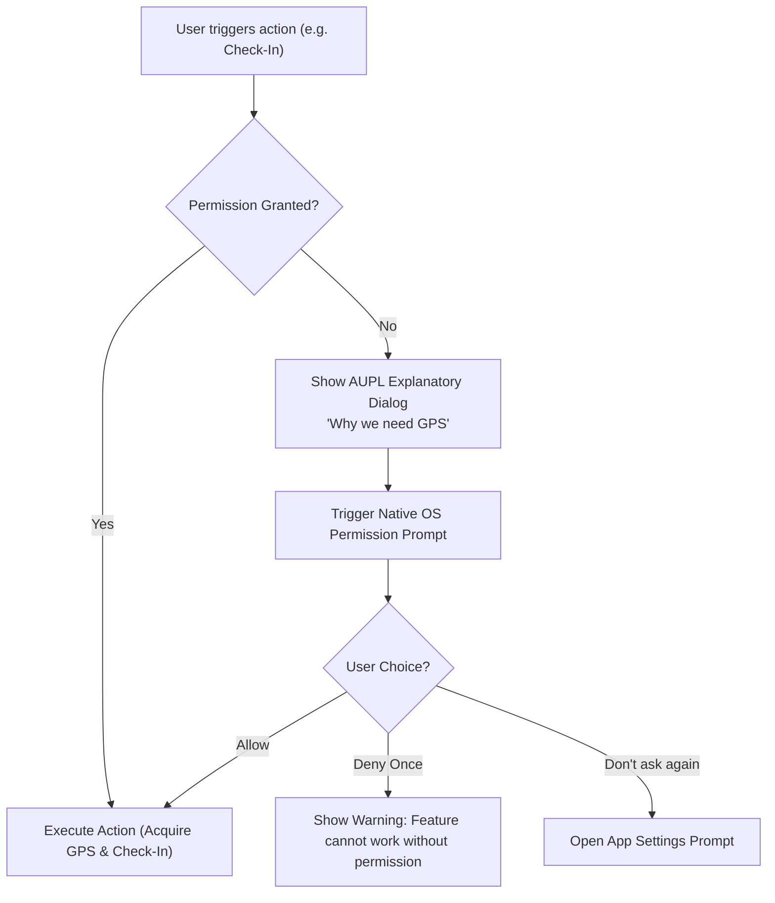

# AUPL Sales Team App — Hardware & OS Permissions (PERMISSIONS.md)

**Company:** ANSU UDYOG PRIVATE LIMITED (AUPL)  
**Target Platform:** Android OS (API 24 to API 35)  
**Document Version:** 1.0.0  

---

## 1. Complete Permissions Manifest

The application requests only necessary permissions required to fulfill field verification, photo auditing, printing, and synchronization.

| Android Permission | Android API Level | Protection Level | Purpose & Core Feature |
|---|---|---|---|
| `android.permission.ACCESS_FINE_LOCATION` | API 1+ | Dangerous (Runtime) | High-accuracy GPS verification for 50–100m outlet check-in (**Rule 3**). |
| `android.permission.ACCESS_COARSE_LOCATION` | API 1+ | Dangerous (Runtime) | Fallback approximate location while satellite lock is being acquired. |
| `android.permission.CAMERA` | API 1+ | Dangerous (Runtime) | Capturing retail store signboards, UPI QR scanning, and cheque photos. |
| `android.permission.BLUETOOTH_CONNECT` | API 31+ (Android 12+) | Dangerous (Runtime) | Connecting to wireless portable ESC/POS thermal printers for receipts. |
| `android.permission.BLUETOOTH_SCAN` | API 31+ (Android 12+) | Dangerous (Runtime) | Discovering nearby Bluetooth thermal printers without sharing location. |
| `android.permission.POST_NOTIFICATIONS` | API 33+ (Android 13+) | Dangerous (Runtime) | Receiving Firebase push notifications for targets, route updates, and announcements. |
| `android.permission.INTERNET` | API 1+ | Normal (Install-time) | Bi-directional synchronization with Firebase Cloud Firestore and Cloud Functions. |
| `android.permission.ACCESS_NETWORK_STATE` | API 1+ | Normal (Install-time) | Detecting cell signal drops and triggering the offline sync engine upon reconnection. |
| `android.permission.READ_MEDIA_IMAGES` | API 33+ (Android 13+) | Dangerous (Runtime) | Selecting stored invoice PDFs and shop receipts from device gallery. |

---

## 2. Runtime Permission Request Lifecycle

To maintain high user trust and prevent store visit interruptions, permissions are requested **contextually just-in-time** rather than in an overwhelming burst on first launch.

---

## 3. Explanatory Rationale Dialogs (UI Copy)

### 3.1 Location Permission Rationale
> **Location Required for Store Visit**  
> *"ANSU UDYOG PRIVATE LIMITED requires high-accuracy location access to verify that you are physically present at the retail outlet (within 100 meters) before recording sales orders and cash collections. Your location is only read when checking in."*  
> **[Grant Location Access]**

### 3.2 Camera Permission Rationale
> **Camera Required for Cheque & QR**  
> *"Camera access is required to scan UPI payment QR codes and capture verification photos of retail store signs and cheque leaves."*  
> **[Grant Camera Access]**

### 3.3 Bluetooth Permission Rationale
> **Bluetooth Required for Thermal Printer**  
> *"Bluetooth access is required to connect to your portable thermal printer and print immediate paper payment receipts for store owners."*  
> **[Grant Bluetooth Access]**

---

## 4. Graceful Degradation Policies

* **Location Denied:** The salesman can still view product catalogs, inspect previous order history, and view customer ledger statements in read-only mode. However, the **[Check-In]**, **[Record Sale]**, and **[Record Collection]** buttons are strictly locked with a prominent permission banner.
* **Camera Denied:** Salesman can still record cash and UPI transactions by typing the 12-digit UTR reference number manually instead of scanning.
* **Bluetooth Denied:** Receipts and A4 statements can still be shared digitally via WhatsApp or exported as PDF files.
