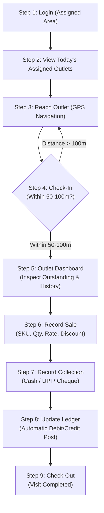
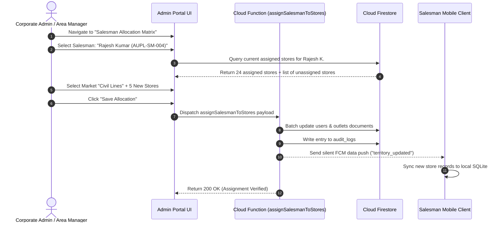

# AUPL Sales Team App — End-to-End User Flows (USER-FLOWS.md)

**Company:** ANSU UDYOG PRIVATE LIMITED (AUPL)  
**Document Version:** 1.0.0  

---

## 1. Field Salesman Daily 9-Step Workflow

This is the canonical operational journey executed by every AUPL field sales representative daily.

### Detailed Step Breakdown:

#### Step 1: Login (Assigned Area)
* Salesman opens AUPL App.
* Authenticates via registered Mobile Number and OTP.
* Device hardware binding verifies that this is the salesman's authorized smartphone.
* App fetches assigned territories and pulls the latest outlet master and SKU pricing data into local SQLite.

#### Step 2: View Today's Assigned Outlets
* Salesman enters the **Outlets** module.
* Filters or selects market (e.g. `Kanpur > Civil Lines`).
* System presents the assigned route, sorting stores by optimal visit sequence and distance relative to current GPS.
* Stores are color-coded (Red = Unvisited, Amber = In Progress, Green = Visited).

#### Step 3: Reach Outlet (GPS Location)
* Salesman drives to the physical retail store (`Sharma Medical Store`).
* The app calculates live geodesic distance to the store's registered coordinates.

#### Step 4: Check-In (Within 50–100m Radius)
* While outside the geofence (>100m), the **[Check-In]** button remains disabled, showing remaining distance.
* As soon as salesman reaches the store threshold ($\le 100\text{m}$), the button turns vibrant AUPL Green.
* Salesman taps **[Check-In]**.
* Hardware location is verified (anti-mock test passed, accuracy $\le 25\text{m}$).
* Visit session is created with timestamp and coordinates.

#### Step 5: Outlet Dashboard (Check Outstanding & History)
* Salesman reviews the store's current financial profile:
  * Credit Limit: ₹50,000
  * Current Outstanding: ₹18,400
  * Overdue Invoices: 1 invoice overdue by 12 days.
  * Recent order history and product purchase preferences.

#### Step 6: Record Sale (SKU, Qty, Rate, Discount)
* Salesman takes the store owner's inventory requirements.
* Taps **[Record Sale]**.
* Selects SKUs from the catalog, adjusts quantities using steppers, applies authorized dealer discount.
* System verifies credit limit availability.
* Order is confirmed; invoice `#AUPL-INV-2026-104` is generated.

#### Step 7: Record Collection (Cash / UPI / Cheque)
* Salesman requests payment against outstanding balance.
* Taps **[Record Collection]**.
* Selects payment method:
  * **Cash:** Enters amount collected (e.g. ₹5,000).
  * **UPI:** Displays AUPL QR; store scans and pays; salesman enters 12-digit UTR.
  * **Cheque:** Enters Cheque number, bank name, and cheque date.
* System issues official payment receipt `#AUPL-RCP-2026-088`.

#### Step 8: Update Ledger (Auto-Executed)
* System automatically executes atomic ledger postings:
  * Invoice amount is debited to party ledger.
  * Collection amount is credited to party ledger.
  * Current outstanding balance is recalculated immediately.
* Salesman can instantly hand over or WhatsApp the updated Mini-Ledger statement.

#### Step 9: Check-Out (Visit Completed)
* Salesman taps **[Check-Out]**.
* Optional prompt to enter visit notes or next follow-up date.
* Visit duration is recorded, store card transitions to `Completed 🟢`, and salesman proceeds to the next store.

---

## 2. Admin User Flows (Web Portal)

### Flow 1: Select Salesman & Assign to Stores / Markets

---

### Flow 2: Bulk Reassignment of Route (Salesman Transfer)
1. Admin navigates to **Salesman Directory**.
2. Selects departing salesman (e.g. `Ramesh Tiwari - Resigned`).
3. Clicks **[Reassign Entire Route]**.
4. Selects replacement representative (e.g. `Amit Singh`).
5. Confirms effective transfer date.
6. System re-points all linked outlets, updates historic assignment pointers, and logs transaction in audit trail.
7. Next time Amit Singh launches his app, all outlets appear immediately on his route.

---

### Flow 3: Single-Click Debtor Aging & Batch A4 PDF Export
1. Finance manager opens **Ledgers & Debtors** in Admin Console.
2. Selects filter: `District: Kanpur`, `Aging: > 60 Days Overdue`.
3. Table displays 14 delinquent retail accounts with total exposure.
4. Clicks **[Batch Export Statements (A4 PDF)]**.
5. System compiles standardized ISO A4 PDF statements with AUPL header and legal sign-off.
6. Documents are bundled into a ZIP file or dispatched directly to store proprietors via automated WhatsApp API.

---

## 3. Edge Case Handling Flows

| Edge Case Scenario | System Behavior & Mitigation |
|---|---|
| **GPS Inaccuracy / Weak Satellite Signal** | If device GPS accuracy is degraded (>35m), the app warns the salesman and displays a satellite signal acquisition bar. The check-in button remains safely gated until an accurate fix is verified. |
| **Complete Cellular Outage in Deep Bazaar** | App seamlessly transitions to local SQLite mode. Transactions receive a temporary local sequence number and `syncStatus = PENDING`. The salesman can print via Bluetooth or share via local Bluetooth/Wi-Fi direct. |
| **Duplicate Button Press by User** | All transactional action buttons disable instantly upon first tap with a loading spinner. Client generates a deterministic UUID v4 idempotency token before the network call starts. |
| **Cheque Dishonor / Bounce** | Admin portal marks the cheque collection as `BOUNCED`. The backend posts a compensating debit adjustment to the party ledger with a bounce penalty fee and sends an alert to the salesman. |
